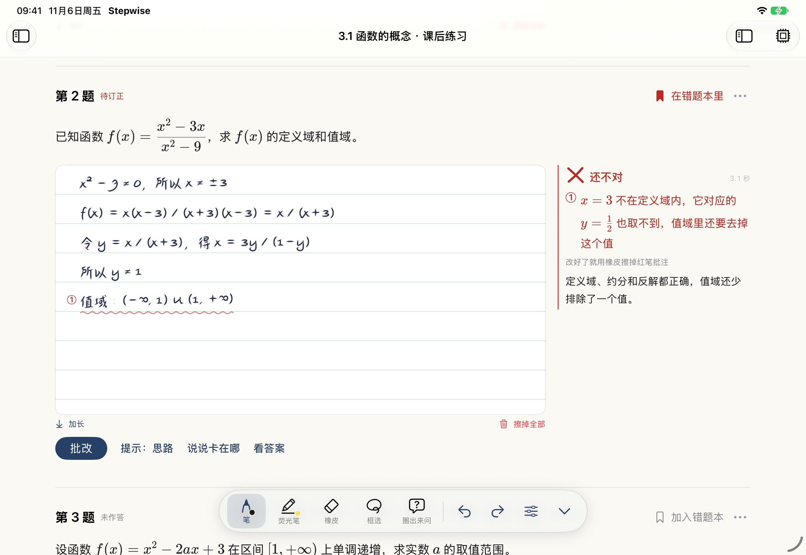
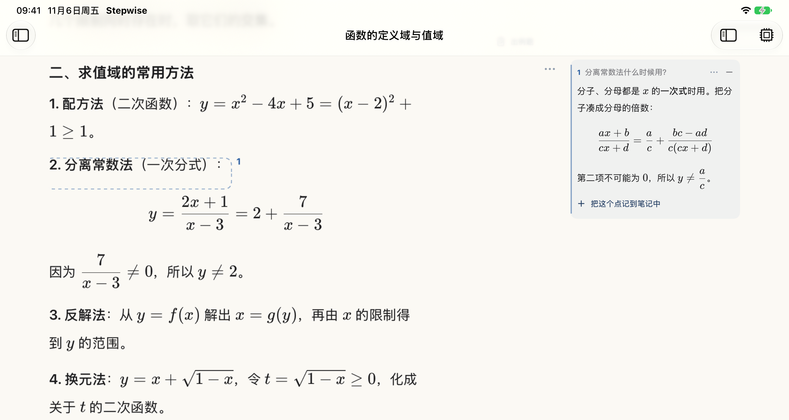
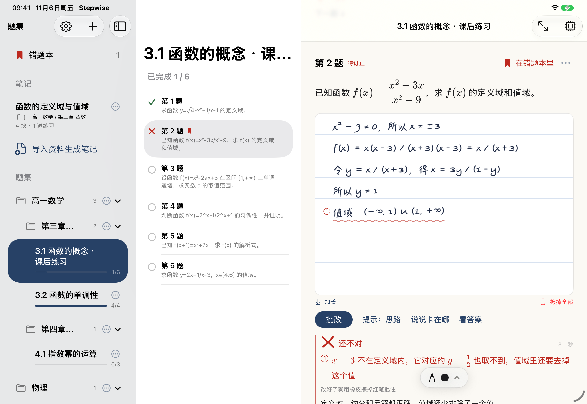
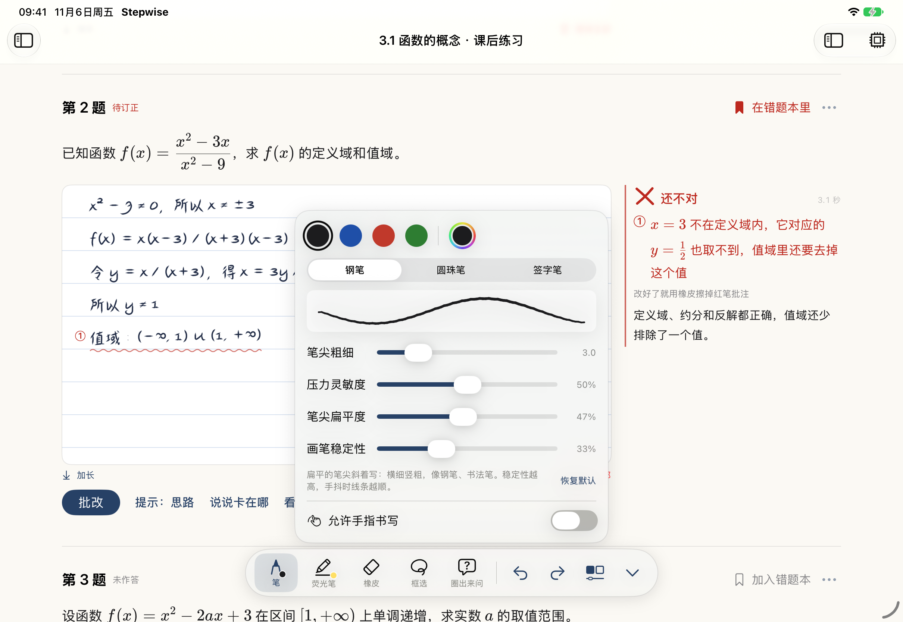
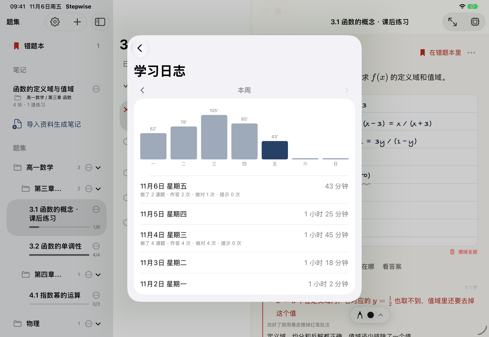

# Stepwise · AI 刷题助手（iPad）

用你自己的 AI，在 iPad 上做题和整理笔记。有两种用法：

- **做题**：导入题目文件，AI 把每道题拆开，整个题集变成一本可以直接用 Apple Pencil 手写的笔记本。写完点“批改”，AI 像老师用红笔改作业一样，在出错的那一行下面画线、写短评；卡住了可以一档一档要提示，或者圈出某一步来问；做完还能总结技巧、出一道变式题。
- **笔记**：导入课件、讲义或教材，AI 按你的要求整理成一份可以直接编辑的笔记，用来预习和复习。可以直接在笔记上写字、画荧光笔，用笔圈住一段提问，回答写在页边；没有例题的重要知识点后面可以加练习题，在笔记里直接手写作答、批改。做题卡住时，App 会先引导你回笔记里看相关的知识点。



<table>
<tr>
<td width="50%"><br><sub><b>笔记</b>：资料整理成可编辑的笔记，圈住一段提问，回答写在页边</sub></td>
<td width="50%"><br><sub><b>题集</b>：分级文件夹、错题本、笔记和做题进度</sub></td>
</tr>
<tr>
<td width="50%"><br><sub><b>工具栏</b>：笔型、颜色、笔尖粗细、压力灵敏度、扁平度、稳定性</sub></td>
<td width="50%"><br><sub><b>学习日志</b>：自动统计学习时间，按周看，AI 写周报</sub></td>
</tr>
</table>

**第一次用？按下面的教程从头做一遍，大约 15 分钟。**

## 目录

- [开始之前：你需要准备什么](#开始之前你需要准备什么)
- [第一步：把 App 装到 iPad 上](#第一步把-app-装到-ipad-上)
- [第二步：申请一个 API Key](#第二步申请一个-api-key)
- [第三步：在 App 里填好 Key、选好模型](#第三步在-app-里填好-key选好模型)
- [第四步（可选）：给不同的事情配不同的模型](#第四步可选给不同的事情配不同的模型)
- [第五步：开始做题](#第五步开始做题)
- [第六步：生成和使用笔记](#第六步生成和使用笔记)
- [工具栏和手写](#工具栏和手写)
- [学习时间、周报和时钟](#学习时间周报和时钟)
- [更新到新版本、换 iPad](#更新到新版本换-ipad)
- [常见问题和报错](#常见问题和报错)
- [功能一览](#功能一览)

---

## 开始之前：你需要准备什么

| 需要 | 说明 |
|---|---|
| 一台 iPad | 系统 iPadOS 17 或更高（设置 → 通用 → 关于本机 → iPadOS 版本） |
| Apple Pencil（推荐） | 做题和笔记都是手写。没有笔也能用：在工具栏里打开“允许手指书写” |
| 一个 AI 服务的 API Key | Stepwise 本身不提供 AI，需要你自己去 AI 服务商那里申请一个“钥匙”，按用量付费（几块钱可以用很久）。下面第二步会一步一步教 |

Stepwise 没有账号、没有服务器：你的题目、笔记、手写都只存在自己的 iPad 上；做题时，App 直接把题目和你的手写图片发给你选的 AI 服务商，不经过任何第三方。

---

## 第一步：把 App 装到 iPad 上

Stepwise 目前不在 App Store 上，用苹果官方的免费 App **Swift Playgrounds** 运行，不需要电脑。

1. 在 iPad 的 App Store 搜索并安装 **Swift Playgrounds**（苹果出品，免费）。
2. 用 iPad 的 **Safari** 打开本页面（GitHub 上的 Stepwise 仓库）。
3. 点页面上绿色的 **Code** 按钮 → 选 **Download ZIP**。如果 Safari 问“是否下载”，点“下载”。
4. 打开 iPad 自带的 **“文件”** App → 左边栏选 **“下载”**，找到 `Stepwise-main.zip`，**点一下**它，会自动解压出一个 `Stepwise-main` 文件夹。
5. 点进 `Stepwise-main` 文件夹，点 **`Stepwise.swiftpm`**，会自动用 Swift Playgrounds 打开。
6. 点右上角的 **▶︎（运行）**。第一次需要编译一两分钟，耐心等一下。

> 以后再打开：直接打开 Swift Playgrounds，首页列表里点 Stepwise 就行。

**有 Mac 的话**也可以装成桌面上的独立 App：用 Xcode 打开 `Stepwise.swiftpm`，用数据线连接 iPad，在 Signing & Capabilities 里选你的 Apple ID，点运行。免费 Apple ID 签名的 App 7 天后会打不开，到时连上 Mac 再运行一次即可。

---

## 第二步：申请一个 API Key

### API Key 是什么？

API Key 是一串很长的字符（通常以 `sk-` 开头），相当于你在 AI 服务商那里的“钥匙 + 钱包”：App 拿着它去调用 AI，费用从你的账户里扣。

- **它等于钱**：不要发给别人、不要截图发群里。泄露了就去服务商后台把它删掉，重新建一个。
- **按用量计费**：批改一道题大约是发一张图片加几百个字，单次费用很低。建议第一次只充值一个小金额（例如 10–20 元），用一段时间看看实际花费。很多平台可以设置消费上限，建议设上。
- Stepwise 把 Key 保存在 iPad 的系统钥匙串里，只发给你填写的那个服务商。

### 选哪个服务商？

**最重要的一条：要选“能看图”的模型。** 你的手写作答是以图片形式发给 AI 的，扫描件和公式多的 PDF 也是。不能看图的模型（比如 DeepSeek）只能处理纯文字题目和键盘作答。

按你的情况选一个就够了，以后随时可以再加：

| 你的情况 | 推荐 | 说明 |
|---|---|---|
| 在国内，想最省事 | **通义千问**（阿里云百炼） | 支付宝付款，模型多，`qwen-vl-max` 等带 `vl` 的模型能看图 |
| 在国内，备选 | **智谱 GLM**、**Kimi**、**豆包（火山方舟）** | 都是国内平台；智谱选带 `v` 的模型（如 `glm-4.5v`）；豆包需要在控制台里先开通模型 |
| 想一个 Key 用遍 GPT、Claude、Gemini 等 | **聚合平台**：硅基流动、AIHubMix、302.AI、DMXAPI（国内可付款）；OpenRouter（需要海外支付方式） | 一个 Key 调用很多家的模型，在 App 里点“获取模型列表”挑选 |
| 能使用海外服务 | **Google Gemini**、**OpenAI**、**Anthropic Claude**、**xAI Grok** | Gemini 在 Google AI Studio 申请，有免费额度；其他几家需要海外手机号 / 信用卡 |

> 各平台的注册方式、价格、免费额度经常变化，以官网为准。

### 申请 Key 的通用步骤

各家后台长得不一样，但流程都差不多：

1. 用浏览器打开服务商的开发者平台（网址见下表），注册并登录（国内平台一般需要手机号和实名认证）。
2. 充值一点余额（有免费额度的可以先跳过）。
3. 在左侧菜单或右上角头像里找 **“API Key” / “API 密钥” / “密钥管理”**，点 **“创建”**。
4. **马上复制**生成的 Key。很多平台只显示一次，关掉就看不到了；没复制到的话，删掉重新建一个即可。
5. 用 iPad 申请的，直接复制；用电脑申请的，可以用“通用剪贴板”、备忘录或隔空投送传到 iPad（不要通过聊天群发送）。

| 服务商 | 去哪里申请 | 备注 |
|---|---|---|
| 通义千问 | 阿里云百炼控制台（bailian.console.aliyun.com） | 带 `vl` 的模型能看图 |
| Kimi | platform.moonshot.cn | `kimi-latest` 和带 `vision` 的模型能看图 |
| 智谱 GLM | open.bigmodel.cn | 带 `v` 的模型（如 `glm-4.5v`）能看图 |
| 豆包 | 火山方舟控制台（console.volcengine.com/ark） | 要先在控制台里开通模型；App 里的“模型”填控制台给的模型 ID 或接入点 ID |
| DeepSeek | platform.deepseek.com | **不能看图**，只适合纯文字题、键盘作答，或者专门用来出题 |
| 硅基流动 | cloud.siliconflow.cn | 聚合平台 |
| AIHubMix / 302.AI / DMXAPI | aihubmix.com / 302.ai / dmxapi.cn | 聚合平台，接口地址以平台后台为准 |
| OpenRouter | openrouter.ai | 聚合平台，需要海外支付方式 |
| Google Gemini | aistudio.google.com | 点 “Get API key” |
| OpenAI | platform.openai.com | |
| Anthropic Claude | platform.claude.com | |
| xAI Grok | console.x.ai | |

---

## 第三步：在 App 里填好 Key、选好模型

### 第一次打开

1. 第一次运行会先出现 **“使用前请了解”**，说明你的数据会发到哪里。看完点 **“同意并继续”**。
2. 接着会自动打开 **设置**。以后要进设置：点左侧栏顶部的 **⚙︎ 齿轮**。

### 填写 API Key

1. 在设置里往下翻到 **“模型服务商”**，点你申请 Key 的那一家（比如“通义千问”）。
2. 在最上面的 **“API Key”** 输入框里**粘贴**你的 Key。粘贴就会自动保存，不需要点保存。注意前后不要多出空格或换行。
3. 点 **“获取模型列表”**。成功后会显示“已获取 xx 个模型”，说明 Key 没问题。
   - 失败了？看下方[常见问题和报错](#常见问题和报错)。
   - 有的服务商不返回模型列表，那就在模型页最下面 **“手动填写模型名称”**，名称以服务商后台显示的为准。

### 选模型

1. 点 **“模型”** 这一行，进入模型列表。
2. 顶部可以**搜索**（例如输入 `vl`、`flash`、`claude`），也可以按厂商筛选。
3. 每个模型后面的小标签：
   - **看图**：能看图片。**做手写题必须选带“看图”的模型。**
   - **快**：反应快的轻量模型，适合专门用来批改。
   - 列表最上面的 **推荐** 分组会按用途把合适的模型排在前面。
   - “看图”“快”是根据模型名字推测的，个别模型可能不准，以服务商说明为准。
4. 点一个模型就选中了。点模型后面的 **☆** 可以把它加为**常用**。做题时右上角的模型菜单只显示常用模型，聚合平台几百个模型时特别有用。

**不知道选哪个？** 先选这些（以下是写这篇说明时的名字，模型更新很快，列表里找名字相近、版本更新的即可）：

| 服务商 | 平时做题用 |
|---|---|
| 通义千问 | `qwen-vl-max` |
| 智谱 GLM | `glm-4.5v` |
| Kimi | `kimi-latest` |
| Google Gemini | `gemini-2.5-pro`（想快就选 `gemini-2.5-flash`） |
| OpenAI | `gpt-5`（想快就选 `gpt-5-mini`） |
| Anthropic Claude | `claude-sonnet-…`（想快选 `claude-haiku-…`） |
| 聚合平台 | 搜上面这些名字 |

### 设为当前使用，并测试

1. 回到这个服务商的页面，点 **“设为当前使用”**，按钮会变成“正在使用”。
2. 点 **“测试连接”**。看到 **“✅ 连接成功”** 就全部搞定了。
3. 回到设置首页，最上面的 **“当前使用”** 会显示你选的服务商和模型。

> 做题时也可以随时切换模型：点页面右上角显示模型名字的按钮（带一个芯片图标），在菜单里选别的服务商或模型。

### 用的服务商不在列表里？

在 **“模型服务商”** 最下面点 **“添加自定义服务商（OpenAI 兼容）”**，填写：

- **名称**：随便起，比如“我的中转”。
- **接口格式**：绝大多数选 **OpenAI 兼容**。
- **接口地址**：服务商文档里的 Base URL，通常以 `/v1` 结尾，例如 `https://xxx.com/v1`（不要带 `/chat/completions`）。
- 然后和上面一样：粘贴 Key → 获取模型列表 → 选模型 → 设为当前使用 → 测试连接。

---

## 第四步（可选）：给不同的事情配不同的模型

只设一个“当前使用”的模型就能用全部功能。想更快或更省钱，可以在设置里给下面几件事**单独**选模型（不选就是“跟随当前模型”）：

| 设置里的位置 | 用来做什么 | 适合什么模型 |
|---|---|---|
| **当前使用** | 拆题、看完整答案、继续对话、笔记里提问 | 能看图、能力强的主力模型 |
| 批改速度 → **批改与提示模型** | 点“批改”和“提示”时用 | **又快又能看图**（列表里同时带“快”和“看图”），例如 Gemini Flash、Claude Haiku、GPT-5 mini、通义 / 智谱的 flash 视觉模型 |
| 做完一道题之后 → **出新题模型** | 出变式题、预先求解答案 | 推理能力强的（名字里常带 pro、opus、reasoner、thinking）；只出文字题时 DeepSeek 也可以 |
| 笔记 → **整理笔记模型** | 导入资料生成笔记 | 上下文长、归纳能力强、能看图的，例如 Gemini Pro、Claude Sonnet、GPT-5、Qwen-VL-Max |

设置方法：在对应位置先选**服务商**（只列出已经填了 Key 的），再点“模型”选具体模型。

几个开关：
- **快速批改**：批改和提示时让模型少思考，更快。
- **预先求解答案**：没有参考答案的题，你在写的时候 AI 先在后台解一遍，批改时只需对答案，更快也更准。每题多用一次 API。
- **显示用时**：在批改结果上显示花了几秒。

**推荐组合**

- **只想用国内平台**：当前使用 `qwen-vl-max`；批改与提示选通义里带 `vl` 和 `flash` / `plus` 的快模型；出新题可以加一个 DeepSeek 的 Key 用 `deepseek-reasoner`。
- **一个聚合平台搞定**：当前使用 Claude Sonnet 或 GPT-5；批改选 Gemini Flash 或 Claude Haiku；整理笔记选 Gemini Pro。
- **用 Gemini**：当前使用和整理笔记用 `gemini-2.5-pro`，批改用 `gemini-2.5-flash`。

---

## 第五步：开始做题

1. **导入题目**：点左侧栏的 **＋** → **导入题目**。
   - 可以选文件（PDF / 图片 / 文本）、从相册选图片、**扫描纸质题目**，或者直接粘贴题目文字。
   - **按图片识别 PDF**：扫描件、公式和图形多的题目建议打开。需要能看图的模型。
   - **拆分要求（可选）**：比如“每个小问单独作为一道题”。
   - 可以起个名字，放到某个文件夹里。
   - 点 **开始拆分题目**，等 AI 把题目一道道分开。拆错了可以在题目上手动编辑。
2. **手写作答**：每道题下面是横线纸，直接用 Apple Pencil 写。写到底部会自动加长，也可以点“加长”。
3. **批改**：写完点 **批改**。
   - 对了：页边一个红勾。
   - 错了：出错的那一行下面画一道淡红色波浪线并标上序号，页边按序号写清楚哪里错、为什么错，但不直接给答案。
   - 改好之后用橡皮擦掉红线就行。
4. **卡住了**：
   - 点 **提示**，一档一档给：思路方向 → 关键一步 → 下一步写什么。
   - 点 **说说卡在哪**，可以先写几句自己卡在哪里再要提示。
   - 用工具栏上的 **圈出来问**，圈住自己写的某一步，问“这一步为什么不对”。
   - 实在不会，点 **看答案**。
5. **做完之后**：点题目右上角的 **⋯**，可以总结技巧、讲讲思路、看别的解法、出一道类似的题（新题会自动加到题目后面）。
6. **错题本**：题目右上角点 **加入错题本**。在错题本里 2 轮以内做对，就自动移出。

---

## 第六步：生成和使用笔记

1. 点左侧栏的 **＋** → **导入资料生成笔记**，选课件、讲义或教材（PDF / 图片 / 文本）。
2. **怎么整理（可选）**：比如“预习笔记，重点标出定义和公式”“期末复习提纲”。
3. **例题**：选 **不出**、**必要时出**（资料里没有例题的重要知识点后面出一道）或 **更多例题**。
4. 点 **生成笔记**。AI 写完一块显示一块，中间一栏是目录。
5. 使用笔记：
   - **编辑**：点每块右边的 **⋯** 可以编辑（支持 Markdown 和 `$公式$`）、在下面插入一块、移动、删除。
   - **选中提问**：用手指选中一段文字，可以“解释一下”“举个例子”“出一道练习题”，或者自己提问。回答先单独显示在下面；觉得有用，点回答右边的 ⋯ →“整理进笔记”，AI 会结合这一节的内容把它写成一段正式的笔记，替换掉这块回答。
   - **圈出来问**：用工具栏上的“圈出来问”，用笔圈住一段，直接打字提问。回答写在右侧页边，双击放大。点“把这个点记到笔记中”时不是照抄回答，而是由 AI 结合这一节和整份笔记补写一段新内容，接在这一节后面。
   - **出例题**：每个小节下面有“出例题”，练习题下面可以直接手写、批改，和做题一样。
   - **写写画画**：直接在笔记上用笔写字、画荧光笔。
6. **小技巧**：把笔记和题集放进**同一个文件夹**，做里面的题卡住时，App 会先引导你去看笔记里相关的那一段，并用临时荧光笔标出重点。

---

## 工具栏和手写

- **手指 vs 笔**：默认只有 Apple Pencil 写字，手指用来翻页、选文字、点按钮。没有 Apple Pencil 时，点工具栏上已选中的笔 → 打开 **“允许手指书写”**。
- **工具栏**：贴在页面最下沿，从左到右是笔、荧光笔、橡皮、框选、圈出来问、撤销、重做。笔一落到纸上开始写，工具栏会自动缩成底边中间的小标签，把纸面让出来；要换工具时点一下小标签就展开。点最右边的 ⌄ 也可以一直收起。
- **调参数**：**再点一次已选中的工具**，展开参数面板。
  - **笔**：颜色（色盘可以选任意颜色）、笔型（钢笔 / 圆珠笔 / 签字笔），以及：
    - **笔尖粗细**
    - **压力灵敏度**：越高，轻重写出来的粗细差别越大。
    - **笔尖扁平度**：越高越像钢笔、书法笔，横细竖粗。
    - **画笔稳定性**：越高，手抖时线条越顺。
    - 这几项在你写完一笔、抬起笔之后才生效。
  - **荧光笔**：颜色、粗细、透明度。
  - **橡皮**：局部擦除或整笔擦除、橡皮大小。
- **Apple Pencil 快捷操作**：双击笔身切换橡皮擦；Apple Pencil Pro 按住笔身侧边临时擦除。
- **键盘作答**：设置 → 作答 → 打开“键盘作答”，手写区下面会多一个打字框。

---

## 学习时间、周报和时钟

- **学习时间**：一分钟内有操作（写字、翻页、点按）的时间自动算作学习，停下来不动的时间不算。设置首页会实时显示“已使用 Stepwise 学习 x 天 x 小时 x 分钟”。
- **学习日志和周报**：设置 → 学习日志和周报。按周看每天的学习时间和做题情况，可以让 AI 写一份周报。
- **时钟**：设置 → 时钟，打开后浮在页面上，可以拖到任何位置，双指缩放大小。

---

## 更新到新版本、换 iPad

1. **先备份**：在旧版里打开 设置 → **导出题目和做题记录**，勾选题集和笔记，存到“文件”里。
2. 按[第一步](#第一步把-app-装到-ipad-上)重新下载 ZIP、解压，打开**新解压出来的** `Stepwise.swiftpm` 运行。Swift Playgrounds 首页列表里原来那个是旧版。
3. 在新版里：设置 → **导入题目和做题记录**，选刚才的备份文件。
4. **API Key 不在备份里**（为了安全），需要在新版里重新粘贴一次。学习时间和周报也不在备份里。

换 iPad 也一样：旧 iPad 导出 → 隔空投送到新 iPad → 新 iPad 导入。导入只会新增，不会覆盖已有的内容。

---

## 常见问题和报错

先在设置里对应服务商的页面点 **“测试连接”**，看它说什么：

| 看到的提示 | 原因 | 怎么办 |
|---|---|---|
| **HTTP 401 / 403**：API Key 无效或没有权限 | Key 复制错了、多了空格、被删除了，或者这个 Key 没有开通该模型 | 回服务商后台重新复制或新建一个 Key 粘贴；国内平台检查是否完成实名认证、是否开通了这个模型 |
| **HTTP 404**：接口地址或模型名称不对 | 模型名打错，或者自定义服务商的接口地址不对 | 重新点“获取模型列表”从列表里选；自定义服务商检查接口地址是否以 `/v1` 结尾 |
| **HTTP 429**：请求太频繁或余额不足 | 欠费、免费额度用完，或者短时间请求太多 | 去后台充值或查看额度；稍等一会儿再试 |
| **HTTP 400**：请求被拒绝 | 最常见的原因是给不能看图的模型发了图片 | 换一个带“看图”标签的模型 |
| “获取模型列表”是灰的 | 还没有填 Key | 先粘贴 Key |
| 获取不到模型列表 | 有的服务商不提供这个接口 | 在模型页最下面“手动填写模型名称” |
| 一直转圈、很慢 | 模型在“深度思考”，或者网络慢 | 打开“快速批改”；给“批改与提示模型”选一个带“快”标签的模型 |
| 手写批改说看不清、答非所问 | 模型不能看图，或者看图能力弱 | 换一个能力更强的看图模型 |
| 用国外服务（OpenAI、Claude、Gemini 等）连不上 | 网络无法访问 | 换国内平台或国内可用的聚合平台 |
| 写字时手指一碰就画线 | 打开了“允许手指书写” | 点已选中的笔，在参数面板里关掉 |

还是不行？在 GitHub 上提一个 Issue，附上“测试连接”显示的文字（**不要附上 API Key**）。

---

## 功能一览

### 做题

- **导入与拆题**：PDF、图片、文本，或者扫描纸质题目；公式多的 PDF 会自动按图片识别；选择题的选项不会漏，拆错了可以手动编辑
- **笔记本式做题**：整个题集是一本连续的笔记本，题目下面就是横线纸，直接用 Apple Pencil 写；写到底部自动加长，写到一半切题或退出都不会丢
- **红笔批改**：做错了，出错的那一行下面画一道淡红色波浪线、标上序号，页边按序号写清每一处错在哪、为什么错，不直接给答案；改好了用橡皮擦掉红线
- **分档提示**：思路方向 → 关键一步 → 下一步写什么，按钮上写着下一档是什么；也可以先写几句卡在哪里再要提示
- **圈出来问**：用笔圈住自己写的某一步，问“这一步为什么不对”，回答贴在页边
- **卡住时先看笔记**：做错或要提示时，如果同一个文件夹的笔记里有关联度很高的知识点，题目下面会提示“先看看笔记”，点进去翻到那一段并用临时荧光笔标出重点
- **批改快**：没有参考答案的题会在后台预先解出答案，批改时只需对答案；可以单独选一个快速的看图模型专门批改
- **做完之后**：在题目右上角的 ⋯ 菜单里让 AI 总结技巧、讲思路、比较解法，或出一道变式题加入题目列表；变式题会记住你在原题上犯过的错
- **错题本**：任意一题可以加入错题本；在错题本里 2 轮以内做对，就自动移出

### 笔记

- **导入资料生成笔记**：导入课件、讲义或教材，写一句怎么整理（预习笔记、复习提纲……），AI 一块一块写出可以直接编辑的笔记，中间一栏是目录
- **例题**：导入时选不出 / 必要时出（没有例题的重要知识点后面加一道）/ 更多例题（每个重要知识点后面 1–2 道）；每个小节下面还可以点“出例题”出 1–3 道。练习题下面就是手写区，和做题一样批改
- **直接编辑**：每一块可以改（Markdown + LaTeX）、在下面加一块、上下移动、删除
- **写写画画**：用 Apple Pencil 直接在笔记文字上写字、画荧光笔，颜色和粗细可调；手指照样能选字、翻页
- **圈出来问**：用笔圈住一段，直接打字提问；回答像批注一样写在右侧页边，支持 LaTeX，不影响正文；双击放大，可以“把这个点记到笔记中”，也可以收起成一个小对话图标
- **选中提问**：选中一段文字，可以“解释一下”“举个例子”“出一道练习题”或自己提问
- **问答整理进笔记**：页边批注“把这个点记到笔记中”、回答块的“整理进笔记”，都不是把回答照抄进去，而是结合这一节和整份笔记写成新的一段，沿用前面的符号和例子，不重复已经写过的内容
- **详细记录**：做题时被引导来看笔记，页边会有“详细记录：xxx”，让 AI 把这个知识点补写进笔记

### 学习工具

- **学习时间**：一分钟内有操作的时间自动算作学习时间，停下来不动的时间不算；设置首页实时显示“已使用 Stepwise 学习 x 天 x 小时 x 分钟”
- **学习日志和周报**：按周看每天的学习时间和做题情况，可以让 AI 写一份学习周报
- **时钟**：设置里打开，浮在页面上，颜色和系统深浅色相反，可以拖到任何位置、缩放大小

### 通用

- **使用你自己的 AI**：支持 OpenAI、Claude、Gemini、DeepSeek、通义千问、Kimi、智谱、豆包、Grok，以及 OpenRouter、AIHubMix、302.AI、DMXAPI、硅基流动等聚合平台和任意 OpenAI 兼容接口。可以搜索、按厂商筛选几百个模型，星标常用模型；批改、出新题、整理笔记可以各用一个单独的模型，选模型时推荐的排在最上面
- **手写**：默认只用 Apple Pencil 书写，手指用来翻页和点按钮（没有 Apple Pencil 时可以允许手指书写，键盘作答可在设置里开启）；双击笔身切换橡皮擦，按住笔身侧边（Apple Pencil Pro）临时擦除
- **工具栏**：贴在页面最下沿，开始书写时自动缩成小标签，点一下展开；有笔、荧光笔、橡皮、框选、圈出来问、撤销 / 重做；再点一次已选中的工具展开参数面板。笔：自选颜色，钢笔 / 圆珠笔 / 签字笔，笔尖粗细、压力灵敏度、笔尖扁平度（像钢笔、书法笔那样横细竖粗）、画笔稳定性（手抖时线条更顺），面板里有实时预览；荧光笔：自选颜色，粗细和透明度用滑块拖；橡皮：局部 / 整笔、大小
- **分级文件夹**：题集和笔记都可以按科目、章节放进多层文件夹；同一个文件夹里的笔记，做题卡住时会被优先推荐
- **公式**：LaTeX + KaTeX 排版，KaTeX 已打包在 App 内，离线也能显示
- **纸和笔的界面**：米白纸色的页面，只用墨蓝、红笔、蓝笔和便签黄几种颜色，支持深色模式
- **备份与迁移**：在设置里导出题目、做题记录和笔记（含图片、手写笔迹和笔记上的涂鸦，不含 API Key、设置和学习时间），换一台 iPad 再导入
- **隐私**：没有账号、没有服务器；数据只在本机，API Key 存在系统钥匙串

## 更新日志

### 2026-11-06

- **问答整理进笔记**：笔记里提问之后记到笔记，不再把回答原样抄进去，AI 结合这一节和整份笔记补写一段新内容；选中提问的回答也可以“整理进笔记”。用设置里的整理笔记模型
- **笔记排版**：横竖屏下正文都居中；圈出来问时正文往左让出页边放批注，批注收起后正文回到正中。行内公式不再从中间拆开换行，表格尽量不换行，稍宽的公式自动缩小放进一行；新笔记用更宽的纸，一行放得下更多内容（已经写画过的旧笔记保持原来的排版，笔迹不会错位）
- **工具栏贴边**：工具栏默认贴在页面最下沿；开始书写时自动缩成底边的小标签，点一下展开
- **新工具栏**：仿照 Notability 的大工具栏，可以收起成一个小胶囊；每个工具再点一次展开参数面板。笔可以自选任意颜色，有钢笔 / 圆珠笔 / 签字笔三种，参数有笔尖粗细、压力灵敏度、笔尖扁平度、画笔稳定性；荧光笔的粗细和透明度用滑块拖；橡皮可以调大小
- **笔记上涂鸦**：笔和荧光笔（颜色、粗细在工具栏的参数面板里调），直接写在笔记文字上；手指照样选字、翻页、点按钮，笔才写字
- **笔记里圈出来问**：用笔圈住一段，弹出输入框直接打字或点常用问题；回答是右侧页边的小字批注，支持 LaTeX，不影响正文；双击放大；“把这个点记到笔记中”；可以收起成小对话图标，点一下再展开
- **卡住时先看笔记**：做错或点提示时，到同一个文件夹的笔记里找关联度很高的知识点，题目下面提示“先看看笔记”，点进去翻到那一段并用临时荧光笔标出重点；页边可以“详细记录：xxx”把这个知识点补进笔记，或者“回到题目”。笔记也可以放进文件夹了
- **学习时间**：一分钟内有操作就算学习，停下来不动的时间不算；设置首页实时显示“已使用 Stepwise 学习 x 天 x 小时 x 分钟”；学习日志按周看每天的时间和做题情况，可以让 AI 写学习周报
- **时钟**：设置里打开，黑底白字（深色模式白底黑字），拖到任何位置，双指或滑块调大小

### 2026-11-05

- **批改说明放在页边**：手写区上只留一道淡淡的红色波浪线和序号，不再把短评写在笔迹旁边，几处批注不会挤在一起；同一行有几处错时，序号并排。每一处错在哪、为什么错，写在页边，序号对得上，公式用 LaTeX 排版
- **例题三档**：导入资料生成笔记时，例题可以选“不出”“必要时出”“更多例题”，会记住上次的选择
- **每个小节都能出例题**：笔记的每个小节下面有“出例题”，选出 1 道、2 道或 3 道，由浅入深，依次插在这一小节后面，每道题下面都有手写批改区
- **可以擦掉红笔批注**：用橡皮擦过某一处的波浪线或序号，这一处就消失；“擦掉全部”会连批注一起擦掉。页边列出已擦掉的几处，点“全部显示”恢复

### 2026-11-04

**笔记模式**

- **导入资料生成笔记**：左侧新增“笔记”，导入 PDF / 图片 / 文字，写下整理要求（可以选预习笔记、复习提纲等），AI 一块一块写出笔记，写完一块显示一块。笔记可以直接编辑（Markdown + LaTeX）、在任意位置加笔记块、上移下移、删除；中间一栏是目录，点哪里翻到哪里
- **选中提问**：在笔记里选中一段文字，底部出现固定选项：解释一下、举个例子、出一道练习题、提问…，回答插在那一段下面
- **需要例题**：生成笔记时可以选择在没有例题的重要知识点后面加练习题，练习题下面就是手写区，批改、提示、看答案、红笔标错和做题页完全一样；也可以在任意一块的 ⋯ 菜单里“在下面出一道练习题”
- **单独的整理笔记模型**：设置 → 笔记里可以选一个整理长资料能力强的模型（上下文长、能看图，例如 Gemini 2.5 Pro、Claude Sonnet 4.5、GPT-5），选模型时推荐的排在最上面
- **导出 / 导入包含笔记**：备份文件里也带上笔记和里面的练习、手写

**做题页**

- **直接在笔迹上批改**：像老师用红笔改作业，错的那一行下面画红色波浪线，前面标上序号，旁边写一句短评；页边用同样的序号列出短评，短评里的公式也用 LaTeX 排版。发给 AI 的手写图片左边印了行号，AI 才能说出错在哪一行
- **页边只放一张批注**：最近一次批改、提示或回答；之前的收成一排小标签，点哪个看哪个，新的一到就翻回最新一条并轻轻闪一下
- **提示分三档**：思路方向 → 关键一步 → 下一步写什么，按钮上直接写着下一档是什么
- **圈出来问**：工具条上新增“圈出来问”，用笔圈住某一步，点“这一步对吗？”“这一步为什么不对？”等常用问题或写下想问的，AI 只针对这一步回答。接着写字时蓝框自动隐藏，点页边的“问”标签再显示
- **做对了只留一个勾**：说明折叠起来，点开再看；页面宽时完整答案放在页边，和自己的作答左右对照
- **完整答案可以放大**：页边太窄、推导看不清时，点“放大到题目下方”，答案改成全宽显示在题目下面；点“放回页边”还原，选择会记住
- **页面更简洁**：做完一道题后，出新题、总结技巧、提问等快捷操作收进题目右上角的 ⋯ 菜单，题目下面只留批改、提示和看答案

**界面**

- **界面更像纸和笔**：只用墨蓝、红笔、蓝笔和便签黄几种颜色，换掉了紫色主色和五颜六色的胶囊按钮；批改用手写感的红勾红叉，页边批注不再是彩色卡片，而是纸边的一道竖线；按钮改成纸面上的文字，“补充说明”改叫“说说卡在哪”，“AI 新题”改叫“变式题”
- **图标换回最初的版本**：用回 Swift Playgrounds 自带的叶子图标，去掉了紫色渐变的“台阶 + 对勾”图标

### 2026-10-31

- **分级文件夹**：左边的题集可以放进文件夹，文件夹里还能再建文件夹；点 ⋯ 新建子文件夹、重命名、移动、删除（删除文件夹不会删题目），也可以把题集拖到文件夹上；导入题目时可以选放到哪个文件夹，导出 / 导入备份会保留分类
- **笔记本式做题**：整个题集是一本可以一直往下写的笔记本，题目印在纸上，下面是横线纸手写区，写到底部自动加长；左边的题目列表当目录用，点哪题翻到哪题
- **批改写在页边**：对错用红勾、红叉标在手写区旁边，提示像便签贴在页边，完整答案折叠在题目下方；做完后的总结、讲解、新题写成题目下面的笔记，不再是对话
- **批改更快**：没有参考答案的题，在你做题时由 AI 在后台先把答案解出来，点“批改”时只需对答案
- **模型浏览器**：快速、能看图的模型（Gemini Flash、Claude Haiku、GPT-4.1 mini 等）排在最上面，方便选来批改

### 2026-10-26

- **导出 / 导入题目和做题记录**：在设置里选择题集导出成一个文件，可以存到“文件”或隔空投送到另一台 iPad 再导入。导入只新增，不会覆盖本机已有的内容
- **提示时可以补充说明**：提示按钮旁边新增“补充说明”，写下卡在哪一步，AI 针对你说的地方给提示
- **默认只用手写作答**：键盘作答可以在设置里开启
- **自定义做完一道题之后的操作**：快捷按钮可以增删、改文字、调整顺序
- **单独的出新题模型**：出新题可以选一个推理能力更强的模型
- **新题记住原题**：AI 出的新题会带上你在原题上的作答记录，批改和提示时会特别留意同样的错误
- **对话再长也不变慢**：之前的批改和提示整理成一段简短记录发给 AI，不再发送整段对话；再次检查答案时以这次作答为准重新批改

### 2026-10-21

- **支持 AIHubMix 等聚合平台**：新增 AIHubMix、302.AI、DMXAPI；新的模型浏览器可以搜索、按厂商筛选、标出能看图的模型，星标常用模型后，做题时的菜单只显示常用模型
- **错题本**：每题右上角可以加入错题本，错题本里 2 轮以内做对就自动移出
- **选项不再遗漏**：拆题时选择题的选项一定放进题干；拆错了可以手动编辑题目
- **检查答案更快**：快速批改模式，可以单独选一个批改模型
- **上架准备**：正式图标、首次使用的数据发送说明、隐私政策
- **写一半不丢失**：切到别的题或退出 App，草稿和手写笔迹都会自动保存；按住 Apple Pencil 笔身侧边临时变成橡皮擦
- **题目置顶**：往下滚动时题目浮在最上面，不会被对话挡住
- **手写板**：橡皮擦、框选，只用 Apple Pencil 书写，手指用来移动和缩放
- **首个版本**：导入拆题、逐题检查、分级提示、完整答案、通过后继续对话和出新题，LaTeX 公式排版

## 代码目录

```
Stepwise.swiftpm/
  Package.swift          App 配置
  Sources/App/           全部源代码（说明见 Stepwise.swiftpm/README.md）
  Tools/embed_katex.py   重新打包 KaTeX 的脚本
docs/                    网站：介绍页、隐私政策；screenshots/ 是 README 里的截图
AppStore/listing.md      App Store 上架资料
```

KaTeX 0.16.9 以 MIT 许可内嵌在 `Sources/App/KatexAssets.swift` 中。
