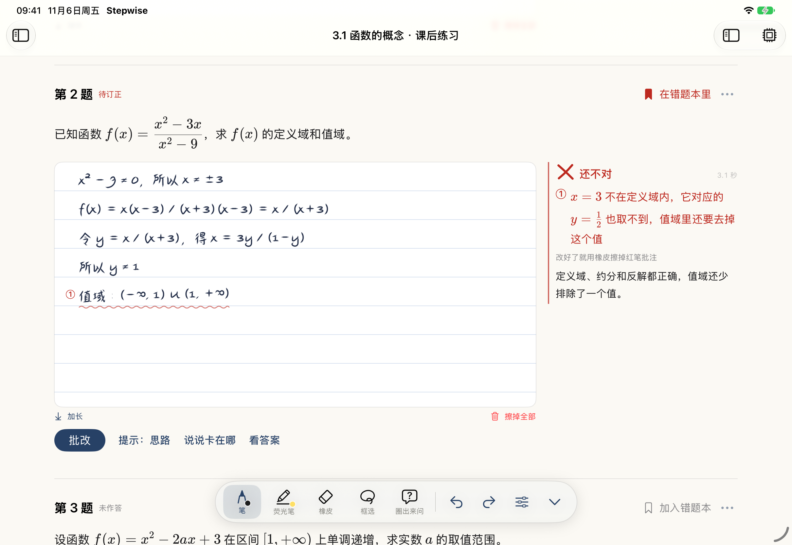
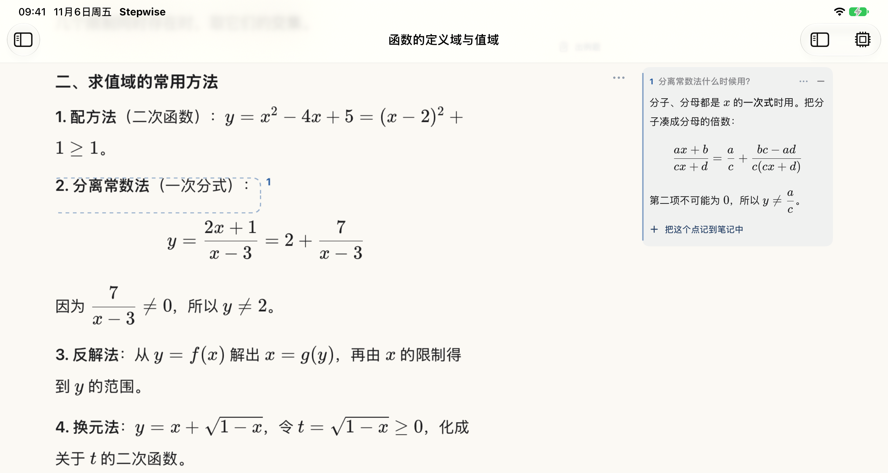
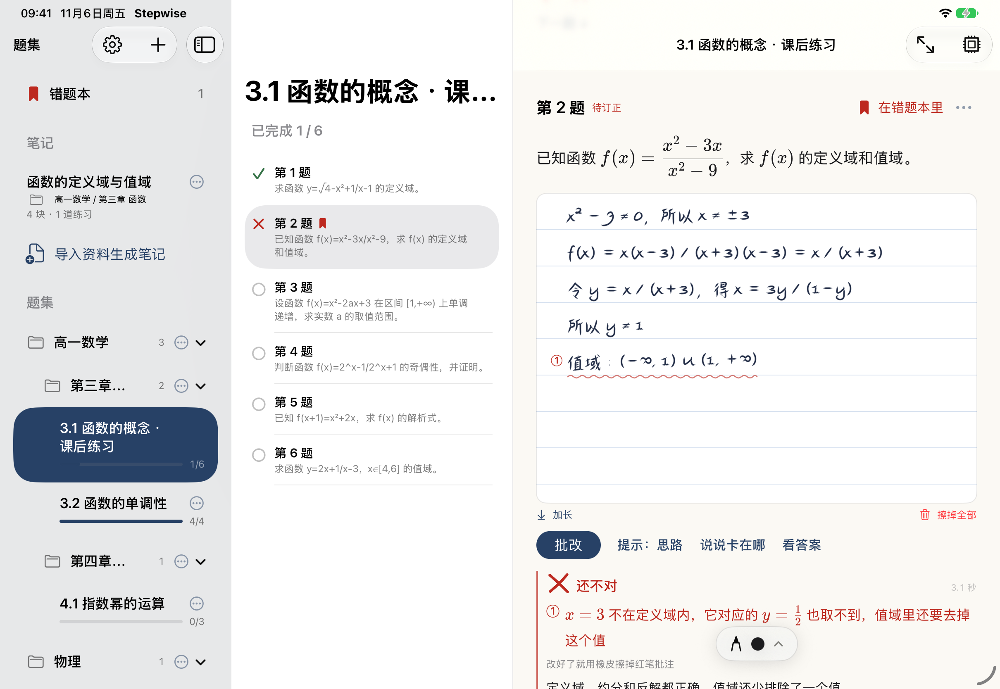
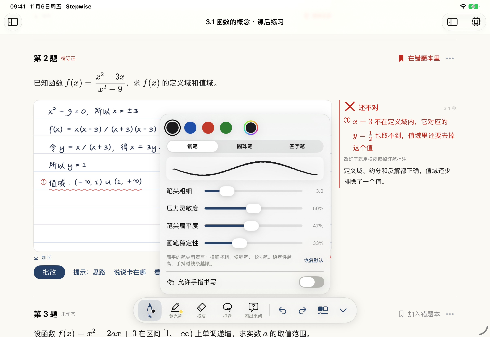
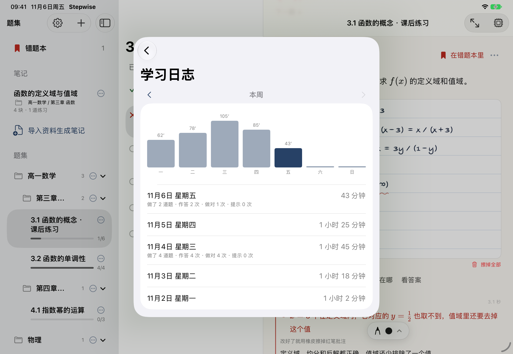

# Stepwise

iPad 上做题和记笔记的 App。用 Apple Pencil 手写作答，AI 检查、给提示；导入课件生成可以编辑的笔记。AI 用你自己的 API Key，没有账号和服务器。

<table>
<tr>
<td width="50%"> 笔记：圈住一段提问，回答写在页边</td>
<td width="50%"> 题集、文件夹、错题本</td>
</tr>
<tr>
<td width="50%"> 工具栏和笔的参数</td>
<td width="50%"> 学习时间和周报</td>
</tr>
</table>

- [安装](#安装)
- [配置 AI](#配置-ai)
- [做题](#做题)
- [笔记](#笔记)
- [AI 白板](#ai-白板)
- [手写和工具栏](#手写和工具栏)
- [设置](#设置)
- [更新版本、换 iPad](#更新版本换-ipad)
- [报错](#报错)

## 安装

需要 iPadOS 17 以上，最好有 Apple Pencil。

1. App Store 安装 Swift Playgrounds。
2. 用 Safari 打开本仓库，Code → Download ZIP。
3. “文件” App → 下载，点开 `Stepwise-main.zip`，进 `Stepwise-main`，点 `Stepwise.swiftpm`。
4. 点右上角 ▶︎。第一次编译要一两分钟。

以后从 Swift Playgrounds 首页打开。有 Mac 也可以用 Xcode 打开 `Stepwise.swiftpm` 装到 iPad，免费 Apple ID 签名 7 天后要重新运行一次。

## 配置 AI

1. 去服务商后台创建 API Key（地址见下表），复制下来。多数平台只显示一次。
2. App 里：⚙︎（左栏顶部）→ 模型服务商 → 选服务商 → 粘贴 Key（自动保存）。
3. 获取模型列表 → 模型 → 选一个。手写作答是以图片发过去的，必须选带“看图”标签的模型。
4. 设为当前使用 → 测试连接。

| 服务商 | 申请地址 | 可以先试的模型 |
|---|---|---|
| 通义千问 | bailian.console.aliyun.com | `qwen-vl-max` |
| 智谱 GLM | open.bigmodel.cn | `glm-4.5v` |
| Kimi | platform.moonshot.cn | `kimi-latest` |
| 豆包 | console.volcengine.com/ark | 先在控制台开通模型，填模型 ID 或接入点 ID |
| DeepSeek | platform.deepseek.com | 不能看图，只适合文字题或出题 |
| 硅基流动 / AIHubMix / 302.AI / DMXAPI | cloud.siliconflow.cn / aihubmix.com / 302.ai / dmxapi.cn | 聚合平台，一个 Key 用多家模型 |
| OpenRouter | openrouter.ai | 聚合平台，需要海外支付 |
| Google Gemini | aistudio.google.com | `gemini-2.5-pro`，快一点用 `-flash` |
| OpenAI | platform.openai.com | `gpt-5`，快一点用 `gpt-5-mini` |
| Anthropic Claude | platform.claude.com | `claude-sonnet-…`，快一点用 `claude-haiku-…` |
| xAI Grok | console.x.ai | |

模型名字更新快，列表里找名字相近、版本更新的就行。点模型后面的 ☆ 加为常用，做题时右上角的模型菜单只列常用模型。

列表里没有的服务商：模型服务商最下面 → 添加自定义服务商（OpenAI 兼容），接口地址填到 `/v1` 为止。

Key 按用量扣费，先充一点试试，能设消费上限就设上。

### 不同的事用不同的模型（可选）

不设就都用“当前使用”的模型。

| 设置项 | 用在哪 | 适合 |
|---|---|---|
| 检查速度 → 检查与提示模型 | 检查、提示、卡了 | 又快又能看图，如 Gemini Flash、Claude Haiku、GPT-5 mini |
| 做完一道题之后 → 出新题模型 | 变式题、预先求解答案 | 推理强的，如带 pro、reasoner、thinking 的 |
| 笔记 → 整理笔记模型 | 生成笔记、整理进笔记 | 上下文长、能看图，如 Gemini Pro、Claude Sonnet |

开关：快速检查（少思考，更快）、预先求解答案（没有答案的题先在后台解一遍，检查更快）、显示用时。

## 做题

| 要做什么 | 怎么做 |
|---|---|
| 导入题目 | 左栏 ＋ → 导入题目。PDF、图片、文本、扫描、粘贴都行；扫描件和公式多的 PDF 打开“按图片识别 PDF”；可以写拆分要求，比如“每个小问单独一题” |
| 改题目 | 拆错了直接在题目上编辑 |
| 作答 | 题目下面的横线纸直接写，写到底自动加长 |
| 检查 | 点“检查”。对了打勾；没对就在出问题的那一行下面画线标号，页边说明哪一步、为什么，不给答案。改完用橡皮擦掉红线 |
| 提示 | “提示”分三档：思路 → 关键一步 → 下一步写什么 |
| 卡住了 | 点“卡了”，AI 看你现在写到哪，指出卡在哪一步 |
| 问某一步 | 工具栏“圈出来问”，圈住那一步再问 |
| 看答案 | “看答案”；栏太窄时在“⋯”里 |
| 做完之后 | 题目右上角 ⋯：总结技巧、讲思路、别的解法、变式题（加到题目后面） |
| 错题本 | 题目右上角“加入错题本”，在错题本里 2 轮内做对自动移出 |
| 整理 | 题集和笔记都能放进多层文件夹，题集可以拖进文件夹 |

## 笔记

| 要做什么 | 怎么做 |
|---|---|
| 生成笔记 | 左栏 ＋ → 导入资料生成笔记。可以写怎么整理（预习、复习提纲），例题选不出 / 必要时出 / 更多 |
| 编辑 | 每块右边 ⋯：编辑（Markdown，公式用 `$…$`）、在下面插一块、移动、删除 |
| 选中提问 | 手指选中文字 → 解释一下 / 举个例子 / 出一道练习题 / 自己问。回答 ⋯ → 整理进笔记 |
| 圈出来问 | 工具栏“圈出来问”，用笔圈一段再提问，回答写在旁边页边，双击放大；“把这个点记到笔记中”会插回提问的位置，原文不改 |
| 出例题 | 小节下面“出例题”，1–3 道，题下面可以手写、检查 |
| 写写画画 | 整页都能用笔写字、画荧光笔，页边和空白处也行 |
| 和题目联动 | 笔记和题集放在同一个文件夹，做题卡住时会先带你看笔记里相关的那段 |
| 手写块 | 每块 ⋯ → 在下面加手写块，或页尾“加一块手写”：和笔记一样宽的空白纸，写到底自动加长；⋯ 里换点阵 / 方格 / 空白 |

## AI 白板

| 要做什么 | 怎么做 |
|---|---|
| 新建 | 左栏“AI 白板”→ 新建白板 |
| 写 | 一大张纸，手指滑动、双指缩放；中间一栏或右上角选点阵 / 方格 / 空白 |
| 检查 | 用“框选”或“圈出来问”圈住题目和解答 → 检查。回复是贴在旁边的便签，有问题的那一行画红色波浪线并标号 |
| 提问 | 圈住之后点“提问…”，自己写或点常用问题 |
| 便签 | 按住标题拖动；− 收起，⋯ 放大或删除；右上角眼睛图标隐藏 / 显示全部；中间一栏点一张翻过去 |

## 手写和工具栏

- 默认只有 Apple Pencil 能写，手指用来翻页、选字。没有笔：点一下已选中的笔 → 允许手指书写。
- 工具栏在页面底部：笔、荧光笔、橡皮、框选、圈出来问、撤销、重做。写字时缩成小标签，点一下展开。
- 再点一次当前工具打开参数。笔：颜色、钢笔 / 圆珠笔 / 签字笔、粗细、压力灵敏度、扁平度、稳定性（抬笔后生效）。荧光笔：颜色、粗细、不透明度。橡皮：局部 / 整笔、大小。
- 双击笔身切换橡皮；Apple Pencil Pro 按住侧边临时擦除。
- 想打字作答：设置 → 键盘作答。

## 设置

| 设置项 | 说明 |
|---|---|
| AI 回答语言 | 跟随界面 / 简体中文 / English / 粤语（DSE）。界面语言跟随系统：简体、繁体（香港用词）、英文 |
| 文件储存位置 | 数据存到自己选的文件夹（可以是 iCloud 云盘）。重装后选回同一个文件夹就恢复，包括 API Key、设置和学习时间。Key 在这个文件夹里没有加密 |
| 用量和费用 | 按天、按模型看 token 和花费。Anthropic 直连和 OpenRouter 自动算钱，其他服务商要自己填每百万 token 的价格 |
| 学习日志和周报 | 一分钟内有操作就算学习时间；按周看，可以让 AI 写周报 |
| 时钟 | 浮在页面上，可拖动、双指缩放 |
| 导出 / 导入题目和做题记录 | 备份题集、做题记录和笔记（含手写），不含 API Key |

## 更新版本、换 iPad

用了“文件储存位置”：新版里选回同一个文件夹就行。

没用的话：

1. 旧版：设置 → 导出题目和做题记录，存到“文件”。
2. 重新下载 ZIP 解压，打开新的 `Stepwise.swiftpm`（Swift Playgrounds 首页原来那个是旧版）。
3. 新版：设置 → 导入题目和做题记录，再粘贴一次 API Key。

换 iPad 一样，备份文件隔空投送过去。导入只新增，不覆盖。

## 报错

先去服务商页面点“测试连接”。

| 提示 | 原因 / 处理 |
|---|---|
| HTTP 401 / 403 | Key 错了、有空格、被删了，或没开通这个模型。重新复制 Key；国内平台查实名和模型开通 |
| HTTP 404 | 模型名或接口地址不对。从模型列表里选；自定义服务商的地址要以 `/v1` 结尾 |
| HTTP 429 | 余额不足或请求太频繁。充值，或等一会儿 |
| HTTP 400 | 多半是给不能看图的模型发了图片。换带“看图”的模型 |
| 获取不到模型列表 | 没填 Key，或服务商不提供列表。到模型页最下面手动填写模型名称 |
| 很慢 | 打开快速检查，给检查与提示模型选带“快”标签的 |
| 看不清手写 | 换看图能力更强的模型 |
| 国外服务连不上 | 网络问题，换国内平台或国内能用的聚合平台 |

还不行就开 Issue，贴上测试连接的提示文字，别贴 Key。

## 隐私

没有账号和服务器。数据在本机或你选的文件夹里，请求直接发给你选的服务商。API Key 存在系统钥匙串。

---

[更新日志](CHANGELOG.md) · 代码在 `Stepwise.swiftpm/Sources/App/`（说明见 `Stepwise.swiftpm/README.md`）· `docs/` 是网站和隐私政策 · `AppStore/listing.md` 是上架资料 · KaTeX 0.16.9 以 MIT 许可内嵌在 `KatexAssets.swift`
